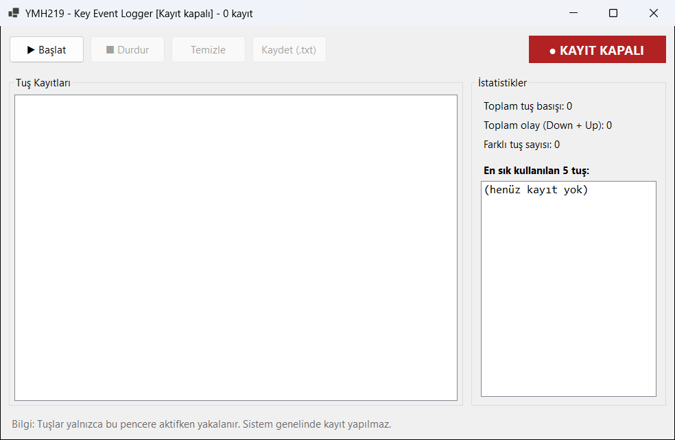
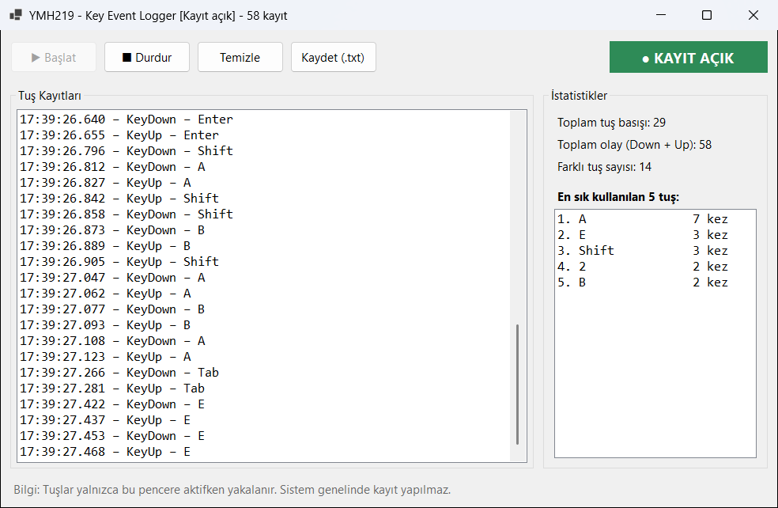

# YMH219 - Key Event Logger (Eğitsel Keylogger)

Windows Forms ile geliştirilmiş, **yalnızca kendi penceresi aktifken** basılan tuşları zaman bilgisiyle listeleyen eğitsel bir masaüstü uygulaması. Amaç, klavye olaylarının (`KeyDown` / `KeyUp`) nasıl yakalandığını, olay bilgisinin nesne tabanlı bir yapıda nasıl işlendiğini ve kayıtların yerel bir `.txt` dosyasına nasıl yazıldığını göstermektir.

> **Güvenlik sınırı:** Bu uygulama gerçek bir sistem keylogger'ı **değildir**. Global klavye kancası (global hook) kullanmaz, arka planda veya gizli çalışmaz, Windows açılışında otomatik başlamaz, başka uygulamalardan veri toplamaz ve kayıtları ağ üzerinden göndermez. Kayıtlar yalnızca kullanıcı **Kaydet** dediğinde, kullanıcının seçtiği konuma yazılır.

Bu proje, YMH 219 Nesne Tabanlı Programlama dersi ek uygulama ödevlerinin **4. ödevidir**.

## Kullanılan Teknolojiler

| Teknoloji | Açıklama |
|---|---|
| C# | Programlama dili |
| .NET 8 (`net8.0-windows`) | Hedef çatı |
| Windows Forms | Masaüstü arayüzü |
| `System.IO.StreamWriter` | `.txt` dosyasına yazma |
| LINQ | En sık kullanılan tuşların sıralanması |
| Visual Studio 2022 / 2026 | Geliştirme ortamı |

Harici NuGet paketi **kullanılmamıştır**.

## Kurulum ve Çalıştırma

### Gereksinimler
- Windows 10 / 11
- [.NET 8 SDK](https://dotnet.microsoft.com/download/dotnet/8.0) veya daha yeni bir SDK
- Visual Studio 2022 (17.8+) veya Visual Studio 2026, **.NET masaüstü geliştirme** iş yüküyle

> Proje `RollForward=Major` ayarına sahiptir. Bilgisayarda .NET 8 çalışma zamanı yoksa daha yeni bir .NET masaüstü çalışma zamanında (ör. .NET 10) da çalışır.

### Visual Studio ile
1. Depoyu klonlayın:
   ```bash
   git clone https://github.com/bakibasbay/YMH219-KeyEventLogger.git
   ```
2. `YMH219-KeyEventLogger.sln` dosyasını Visual Studio ile açın.
3. Üst menüden **Derle > Çözümü Derle** (`Ctrl+Shift+B`).
4. **F5** ile çalıştırın.

### Komut satırı ile
```bash
cd YMH219-KeyEventLogger
dotnet run --project YMH219-KeyEventLogger
```

## Kullanım

1. Uygulama **KAYIT KAPALI** (kırmızı) durumda açılır.
2. **▶ Başlat** butonuna basın; gösterge yeşil **KAYIT AÇIK** olur.
3. Pencere aktifken klavyeden tuşlara basın. Her olay listede şu biçimde görünür:
   ```
   17:31:08.118 – KeyDown – A
   17:31:08.134 – KeyUp – A
   ```
4. **■ Durdur** ile kaydı durdurun. Mevcut kayıtlar silinmez, Başlat ile kaldığınız yerden devam edebilirsiniz.
5. **Kaydet (.txt)** ile kayıtları seçtiğiniz bir metin dosyasına kaydedin.
6. **Temizle** ile (onaydan sonra) ekrandaki kayıtları ve istatistikleri sıfırlayın.

## Özellikler

- `KeyPreview = true` ile **sadece form odaktayken** `KeyDown` ve `KeyUp` olaylarının yakalanması
- Kayıtların `HH:mm:ss.fff – Olay – Tuş` biçiminde milisaniye hassasiyetiyle listelenmesi
- Okunaklı tuş adları (`D1` yerine `1`, `Return` yerine `Enter`, `Space` yerine `Boşluk` vb.)
- **Başlat / Durdur / Temizle / Kaydet** butonları; butonlar duruma göre aktif/pasif olur
- Açık kayıt durum göstergesi: yeşil **KAYIT AÇIK** / kırmızı **KAYIT KAPALI** (pencere başlığında da gösterilir)
- `SaveFileDialog` ile `.txt` olarak kaydetme (tarih-saatli varsayılan dosya adı, UTF-8)
- Dosya işlemlerinde `try/catch` ile hata yönetimi: yetki hatası, dosyanın başka programda açık olması vb. durumlar anlaşılır bir mesajla gösterilir, uygulama kapanmaz
- **İstatistik paneli** (isteğe bağlı geliştirme): toplam tuş basışı, toplam olay, farklı tuş sayısı ve en sık kullanılan 5 tuş
- Temizle işleminde yanlışlıkla silmeye karşı onay penceresi

## Proje Yapısı ve Sınıf Tasarımı

```
YMH219-KeyEventLogger/
├── YMH219-KeyEventLogger.sln
├── README.md
├── screenshots/
└── YMH219-KeyEventLogger/
    ├── Program.cs              # Giriş noktası
    ├── Form1.cs                # Arayüz olayları (butonlar, tuş olayları)
    ├── Form1.Designer.cs       # Kontrollerin yerleşimi
    ├── Models/
    │   ├── KeyEventType.cs     # KeyDown / KeyUp enum
    │   └── KeyLogEntry.cs      # Tek bir kayıt: tuş, zaman, olay türü
    └── Services/
        ├── KeyLogger.cs        # Kayıt durumu, liste, Start/Stop/Clear
        ├── LogFileService.cs   # .txt dosyasına kaydetme
        └── KeyStatistics.cs    # Toplam tuş ve en sık 5 tuş
```

| Sınıf | Sorumluluk |
|---|---|
| `KeyLogEntry` | Bir klavye olayını temsil eder (`Key`, `Timestamp`, `EventType`). Değiştirilemez nesnedir; `ToString()` kayıt biçimini üretir. |
| `KeyLogger` | Kayıt açık/kapalı durumunu ve kayıt listesini kapsüller. `Start()`, `Stop()`, `Clear()`, `Log()` metotları ve `EntryAdded`, `StateChanged` olayları vardır. |
| `LogFileService` | Kayıtları `StreamWriter` ile dosyaya yazar. Hata durumunda istisna fırlatır; mesajı gösterme işi formdadır. |
| `KeyStatistics` | `Dictionary<Keys, int>` ile tuş başına basış sayar, LINQ ile en sık 5 tuşu döndürür. |
| `Form1` | Yalnızca arayüz: kullanıcı etkileşimini alır, ilgili sınıfların metotlarını çağırır ve ekranı günceller. |

## Ekran Görüntüleri

### Kayıt kapalı (açılış ekranı)


### Kayıt açık, tuşlar ve istatistikler


## Bilinen Sınırlamalar / Geliştirme Notları

- Tasarım gereği **yalnızca bu uygulamanın penceresi aktifken** tuşlar yakalanır; başka bir pencereye geçildiğinde kayıt alınmaz.
- `PrintScreen` gibi bazı tuşlar Windows tarafından özel işlendiği için yalnızca `KeyUp` olarak görünebilir. `Alt+Tab`, `Win` gibi sistem kısayolları pencereden çıkışa neden olabilir.
- Bir tuş basılı tutulduğunda Windows'un tuş tekrarı nedeniyle art arda birden fazla `KeyDown` kaydedilir; bunlar istatistikte ayrı basış olarak sayılır.
- Kayıtlar yalnızca bellekte tutulur; **Kaydet** yapılmadan uygulama kapatılırsa kayıtlar kaybolur.
- Kaydet sırasında seçilen dosya varsa üzerine yazılır (Windows kaydetme penceresi bu konuda onay sorar).
- Olası geliştirmeler: kayıtları tarih/saat aralığına göre filtreleme, kapanışta kaydedilmemiş kayıt uyarısı, CSV dışa aktarma.

## Öğrenci

**Muhammed Baki Başbay** – 250541016

YMH 219 Nesne Tabanlı Programlama – Ek Uygulama Ödevleri
